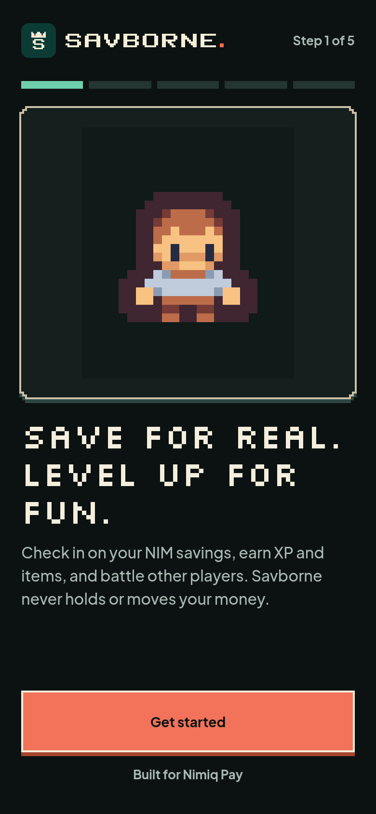
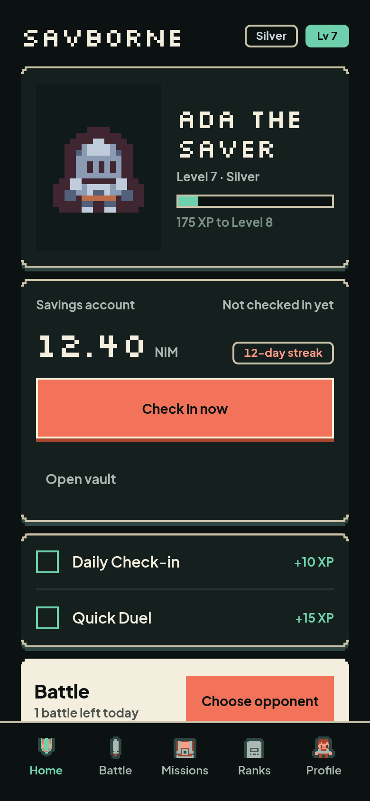
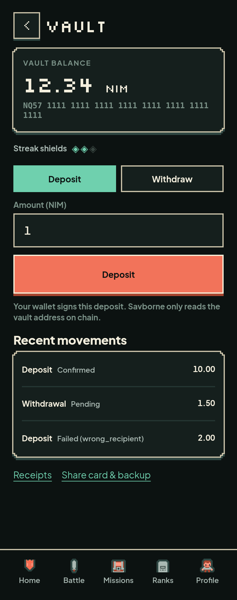
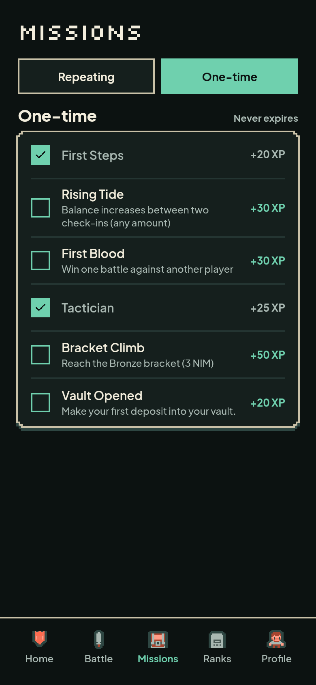
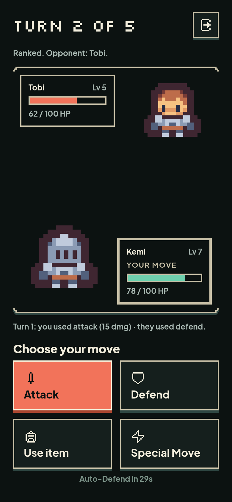
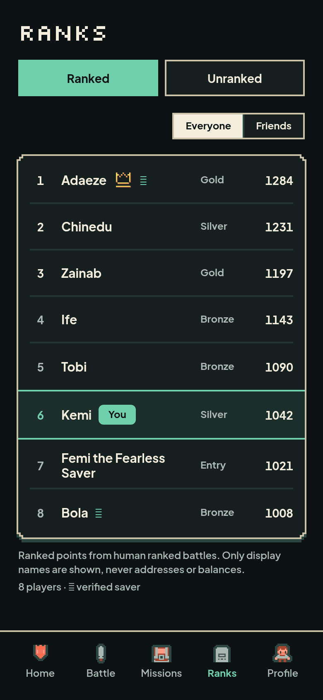

# Savborne

**Save for real. Level up for fun.**

Savborne is a savings RPG that runs inside [Nimiq Pay](https://nimiq.com) as a
Mini App. You keep NIM in a vault only you control, check in daily, and turn the
balance you can see on chain into XP, streaks, items, missions, badges, and rank.

**Live:** [savborne.vercel.app](https://savborne.vercel.app) - open it inside Nimiq Pay, or deeplink with
`nimiqpay://miniapp?url=https://savborne.vercel.app`

[](https://savborne.vercel.app)
[](https://github.com/er4l1m4d/savborne)
[](https://github.com/er4l1m4d/savborne/actions/workflows/ci.yml)
[](LICENSE)
[](https://nextjs.org)

| Welcome | Home | Vault |
|:---:|:---:|:---:|
|  |  |  |
| **Missions** | **Battle** | **Ranks** |
|  |  |  |

Screens are 390-wide renders of the shipped UI with fixture data.

## Why Savborne exists

A wallet shows you a balance. It does not give you a reason to look at it
tomorrow. Savborne is built for Nimiq users who want to save but keep
forgetting, and for anyone who needs a reason to come back: a daily ritual, a
streak that breaks when you skip, and progress you can see.

The game layer is not a skin over a fake number. Every check-in reads the
vault's real balance from the Nimiq chain, and the save itself is the only way
to level up.

## The loop

1. **Create a vault.** Onboarding generates a 24-word phrase on your device
   and derives a vault address from it. The phrase never leaves the device.
2. **Deposit NIM.** Your Nimiq Pay wallet signs a normal transaction to the
   vault address. Savborne never holds or moves the funds.
3. **Check in daily.** The server claims today's stored reading (or reads the
   vault over Nimiq RPC when no reading exists) and awards XP, streak progress,
   missions, items and badge changes exactly once. One claim per UTC day; a
   same-day retry is idempotent. The streak counts claimed days; a daily cron
   also records standing, so a withdrawal is visible without waiting for the
   player to check in, but a snapshot never advances the ritual.
4. **Grow.** Balance brackets (Entry / Bronze / Silver / Gold) unlock items and
   change your character. Missions reward consistency, not deposit size.
5. **Battle.** Duel the AI, challenge a friend, or climb the ranked
   leaderboard. Ranked unlocks after five distinct check-in days.

## How it uses Nimiq Pay

Savborne is built on the Nimiq Pay Mini Apps Framework, not on a Nimiq logo:

- `listAccounts()` identifies the player's wallet for onboarding and sessions.
- `sendBasicTransaction()` signs and sends every deposit from the player's own
  account to their vault.
- `sign()` produces wallet proofs for check-in, account deletion, and the
  12-hour player session. Each proof has its own namespace and action; the
  server verifies that the signing key derives the claimed address, so a proof
  cannot be replayed for another player or action.
- `getHostNetwork()` selects mainnet or testnet at runtime, so the same build
  works in production and in testing.
- `isGetBalanceAvailable()` gates the experience on a Nimiq Pay version that
  supports the SDK, with an honest "update Nimiq Pay" screen instead of a
  broken flow.
- The server reads balances itself over Nimiq RPC (`getAccountByAddress`),
  with ordered fallback endpoints (`NIMIQ_RPC_URLS`) and a per-call timeout. A
  client-reported balance is never accepted, and an RPC outage surfaces as an
  error rather than a zero.

The vault is non-custodial on both sides: deposits are signed by the Nimiq Pay
wallet, withdrawals are signed in-browser by the 24-word phrase, and the server
can read the vault address on chain but cannot move a single luna. If you lose
the phrase and your device, the NIM in the vault is unrecoverable - Savborne
cannot restore it.

## What is in the app

- Non-custodial vault: phrase generation, deposit, on-chain proof, withdrawal,
  receipts, and a shareable player card.
- Daily check-in with a real balance read, XP, streaks, streak shields, and
  idempotent per-day writes.
- Signed player sessions: every route that reads or changes player state
  requires a wallet-signed 12-hour token, not just an address header.
- A daily 00:00 UTC standing snapshot, claimed by the player's next check-in.
- Plain-language terms, a full privacy notice, and signed account deletion.
- Level and bracket progression with unlockable items and a battle loadout.
- Missions: daily and weekly repeating missions plus one-time goals.
- Battles: AI duels, friend challenges, a ranked queue with rating, and a
  five-turn arena with items and special moves.
- Leaderboards: ranked and savings boards, plus a friends view. Display names
  are always shown; level, bracket and score are visible by default and can be
  hidden in Settings. Addresses and balances are never public.
- Profile: character choice, badges, check-in record, and settings.
- Account deletion with a signed proof, plus privacy notice and consent
  capture during onboarding.
- Full error, empty, loading, and offline states, with inline recovery rather
  than dead ends.

## Trust and safety

- **No custody.** The server never has a key that can move NIM. There is no
  withdrawal endpoint that takes an amount from the client.
- **Signed identity.** `POST /api/session` exchanges a wallet signature for a
  12-hour HMAC token backed by a revocable `player_sessions` row; every
  authenticated route, reads included, checks it. A bare
  `X-Player-Address` is never authority. Disconnect revokes every session.
- **Signed actions.** Check-in and delete additionally require their own wallet
  proofs, bound to the address, the action, and a timestamp. Missing, stale, or
  wrong-signer proofs are rejected before any table or chain read.
- **Least privilege.** Supabase RLS denies browser roles on personal tables;
  the app talks to Postgres only through the server with the service role.
- **Ledger integrity.** `check_ins` is unique per player per UTC day,
  `check_in_count` counts claimed days only (a cron snapshot cannot unlock
  ranked), and the reading, player row, rewards, and badge changes commit in
  one transaction. A claim of a cron reading awards exactly once.
- **Rate limits.** Session issue, check-in, player creation, vault creation,
  queue join/poll, battle moves, transfers, profile writes and leaderboard
  reads use fixed-window limits with `429` + `Retry-After`.
- **No secrets in the repo.** Environment values live in `.env.local` and in
  the host's environment; only `.env.local.example` is tracked.

## Tech stack

- **Next.js 16 (App Router) + React 19** - pages, server routes, and the
  Mini App bundle, deployed on Vercel.
- **Supabase (Postgres + RLS)** - game state, matchmaking, missions, and an
  atomic XP ledger.
- **`@nimiq/mini-app-sdk`** - the provider bridge inside the Nimiq Pay WebView.
- **`@nimiq/core`** - vault address derivation and in-browser signing.
- **Tailwind CSS v4** - the pixel-RPG token system (dark green shell,
  mint/coral/butter accents).
- **Plus Jakarta Sans + Silkscreen** - body and display faces, with tabular
  figures for every value that updates.

## Run it locally

Requirements: Node.js 20+, a Supabase project, and a phone with Nimiq Pay for
the in-wallet flows.

```bash
git clone https://github.com/er4l1m4d/savborne.git
cd savborne
npm install
cp .env.local.example .env.local
# fill in NEXT_PUBLIC_SUPABASE_URL, NEXT_PUBLIC_SUPABASE_ANON_KEY,
# SUPABASE_SERVICE_ROLE_KEY, SESSION_SECRET and CRON_SECRET
npm run dev
```

Apply the schema by pasting **`supabase/FINAL-SCHEMA.sql`** into the Supabase
Dashboard SQL Editor and running it. It is fully idempotent, so it is safe on a
fresh database, a partially applied one, or one that already has the schema.
It is the only SQL file and the source of truth for tables, seeds, RLS, grants,
and RPCs.

### Environment

| Variable | Required | Purpose |
|---|---|---|
| `NEXT_PUBLIC_SUPABASE_URL` | yes | Supabase project URL |
| `NEXT_PUBLIC_SUPABASE_ANON_KEY` | yes | Browser key (RLS applies) |
| `SUPABASE_SERVICE_ROLE_KEY` | yes | Server-only database access |
| `SESSION_SECRET` | yes | 32+ bytes; signs the 12-hour player session |
| `CRON_SECRET` | yes | Authenticates Vercel's daily vault-reading cron |
| `NIMIQ_RPC_URLS` | optional | Comma-separated fallback RPC endpoints |
| `NEXT_PUBLIC_NIMIQ_NETWORK` | optional | `mainnet` / `testnet` hint |
| `SENTRY_DSN` | optional | Only if a reporter is explicitly approved |

`GET /api/health` is the readiness probe: 200 only when the database is
reachable, its `schema_meta` version matches the build, and the required RPCs
exist. It exposes no player data and needs no secret.

### Testing inside Nimiq Pay

`getBalance` and the wallet bridge only function inside the Nimiq Pay WebView,
so local testing needs a public HTTPS URL:

```bash
# Option A - Vercel preview
npm i -g vercel && vercel --env-file .env.local

# Option B - tunnel the dev server
npx localtunnel --port 3000
```

Then open the URL in Nimiq Pay or use
`nimiqpay://miniapp?url=<your-tunnel-url>`.

## Quality

```bash
npm test              # 542 tests, 0 failures
npx tsc --noEmit      # clean
npm run lint          # 0 errors, 0 warnings
npm run build         # production build
npm run vault:e2e     # testnet money path: phrase -> address -> faucet -> sign -> send -> settle
npm run checkin:e2e -- https://your-preview.vercel.app
                      # disposable-wallet check-in probe; refuses production
```

CI (`.github/workflows/ci.yml`) runs tests, typecheck, lint, build and an
informational audit on every push and pull request, with no secrets. A
scheduled workflow polls `/api/health` every 15 minutes and fails loudly when
the deployed schema version and the database disagree.

The suite covers the money path, session tokens, check-in signatures, rate
limiting, the weekly XP math, mission evaluation, streaks, badge reachability,
battle resolution, standing freshness, and the API routes that carry money,
identity, and check-in state.

## Repo layout

| Path | Purpose |
|---|---|
| `src/app/` | Next.js App Router pages and API routes |
| `src/lib/` | Supabase and Nimiq wrappers, vault crypto and signing, game logic |
| `src/lib/vault/` | Vault address, RPC, verification, settlement, phrase crypto, receipts |
| `src/components/` | Shared UI, onboarding, battle widgets, and primitives |
| `supabase/FINAL-SCHEMA.sql` | The one idempotent SQL file: schema, seeds, RLS, grants, RPCs |
| `scripts/vault-e2e.mjs` | Testnet end-to-end probe for the money path |
| `scripts/checkin-e2e.mjs` | Disposable-wallet check-in/delete probe for a preview |
| `.github/workflows/` | CI and the 15-minute production health probe |
| `docs/runbooks/` | Schema paste, deploy and incident runbooks |
| `docs/screenshots/` | Shipped-UI renders used in this README |
| `docs/submission-cycle3.md` | Cycle III submission copy |
| `docs/superpowers/` | Specs, plans, audits, and per-batch UI renders |
| `ERRORS.md` | Running log of every build-time and runtime error and its fix |

## Competition

- **Event:** Nimiq Mini Apps Competition, Cycle III
- **Track:** Save - individual savings with a game layer
- **Cycle window:** 14 October 2026 to 11 November 2026
- **Status:** public-readiness hardening in progress; vault, check-in,
  missions, battles, leaderboards, signed sessions, daily readings and account
  deletion are implemented end to end.

## Licence

MIT - (c) 2026 Oluwadamilare ([er4l1m4d](https://github.com/er4l1m4d))

## Contact

`damilareogooluwade@outlook.com`
